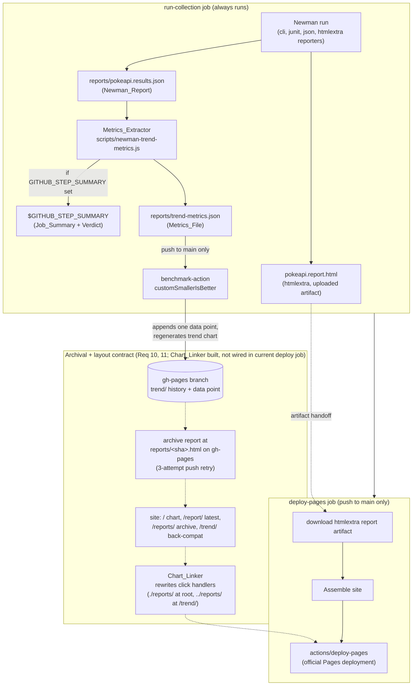

# Design Document

## Overview

This document describes the architecture of the **already-built** Newman trend-metrics and reporting pipeline in this repository. It is documentation of an existing capability, not a plan for new work: every statement below is grounded in code that is already committed. The design exists so that the behavioral contract in [requirements.md](requirements.md) has a structural counterpart — a map of which component owns each requirement, so future changes can be judged against both.

The capability is a **regression contract** over three cooperating pieces:

- **Metrics_Extractor** — `scripts/newman-trend-metrics.js`, a Node.js script that reads a Newman JSON report and emits (a) a GitHub Actions job summary with an all-failures verdict and (b) a benchmark-compatible metrics file.
- **Chart_Linker** — `scripts/link-chart-to-reports.js`, a Node.js script that rewrites the generated trend chart's click handler so a data point opens that run's archived report.
- **CI_Pipeline** — `.github/workflows/postman-ci.yml`, whose `run-collection` and `deploy-pages` jobs orchestrate collection runs, trend extraction, trend history, report archival, site assembly, and publication.

There is no application code under test here. The system exercised is the public PokéAPI; request volume is deliberately low. Reports are gitignored and regenerated every run. Response time is captured only as a trend metric and never gates pass/fail.

### A note on implementation state (honesty about the current workflow)

The three scripts are both fully built. The CI_Pipeline wires in the Metrics_Extractor completely. The **Chart_Linker and the richer site layout (an archived-report store on `gh-pages` and the `/`, `/report/`, `/reports/`, `/trend/` paths) are described by Requirements 5, 6, 10, and 11 and by `docs/api-testing.md`, and the Chart_Linker script that implements the click-rewrite is committed — but the current `deploy-pages` job does not invoke it.** The current `deploy-pages` job assembles a single page: it copies the latest htmlextra report to `site/index.html` (or a placeholder) and deploys that. The repository's git history shows the richer layout was built on an earlier branch and then simplified by commit `679004e` ("refactor: serve only latest htmlextra report at Pages root").

This design documents **both**: the behavior the committed code exhibits today (authoritative), and the archival/layout contract that Requirements 10–11 and the Chart_Linker define (the target the Chart_Linker was built to serve). Where the current workflow diverges from a requirement, this document says so explicitly rather than describing behavior the YAML does not have. This divergence is called out per-requirement in Components and Interfaces and summarized in [Implementation state vs. requirements](#implementation-state-vs-requirements).

## Architecture

The end-to-end data flow runs from a Newman collection run through metrics extraction into two consumers (the job summary and the benchmark trend store), then — on default-branch pushes — into report archival, site assembly, and the official Pages deployment.



Solid edges are flows the committed code performs today. Dotted edges in the **contract** subgraph are the archival/layout behaviors defined by Requirements 10–11 and implemented by the Chart_Linker script, which the current `deploy-pages` job does not yet invoke.

### Control flow and gating

- The **collection run** and everything in `run-collection` is pinned and reproducible. The authoritative pass/fail is the `Run collection` step alone; `set -o pipefail` makes Newman's exit code (not `tee`'s) decide the job result (Req 8.2, 8.3, 8.4).
- The **job summary** and **trend extraction** steps use `if: always()`, so a red run still produces one summary and one data point without altering the collection step's exit code (Req 8.1, 8.2).
- The **trend update** (benchmark-action) and the entire **deploy-pages** job are gated with `github.ref == 'refs/heads/main' && github.event_name == 'push'`, so pull requests, feature branches, schedule, and manual dispatch never touch the published trend or site (Req 9.1, 9.2).

## Components and Interfaces

### 1. Metrics_Extractor (`scripts/newman-trend-metrics.js`)

**Invocation:** `node scripts/newman-trend-metrics.js <results.json> <metrics-out.json>`

**Positional arguments (from `process.argv`):**

| Position | Name | Meaning |
| --- | --- | --- |
| 1 | `resultsPath` | Path to the Newman JSON report to read |
| 2 | `metricsOutPath` | Path where the Metrics_File is written |

**Environment input:** `GITHUB_STEP_SUMMARY` — when present and non-empty, the script appends the Job_Summary to the file it names.

**Outputs:**

1. **Metrics_File** at `metricsOutPath`: a JSON array of exactly three objects, written in order, pretty-printed with two-space indent and a trailing newline (Req 1.1, 2.3).
2. **Job_Summary** appended to `$GITHUB_STEP_SUMMARY` (only when that env var is set) — a Markdown table (Req 3.1, 3.5).
3. A one-line stdout progress message (`Trend metrics: ...`).

**Metrics_File contract (smaller-is-better):** the three entries are, in order:

| name | unit | value |
| --- | --- | --- |
| `Failed assertions` | `count` | `run.stats.assertions.failed` (integer) |
| `Failed requests` | `count` | `run.stats.requests.failed` (integer) |
| `Avg response time` | `ms` | `Math.round(run.timings.responseAverage)` (rounded half-up) |

Every metric is oriented so a *smaller* value is better: assertion health is reported as a **failed**-assertion count (not a passed count) so the single chart direction stays consistent (Req 2.1, 2.2). Missing consumed fields default to zero via `stats.assertions || { total: 0, failed: 0 }`, `stats.requests || { total: 0, failed: 0 }`, and `timings.responseAverage || 0` (Req 1.5).

**Verdict rule (all failures):** the summary's Result row is fail iff *any* of the three failure categories is non-zero:

```
hasFailure = assertions.failed > 0 || requests.failed > 0 || runFailures > 0
```

where `runFailures = Array.isArray(run.failures) ? run.failures.length : 0`. This is the core correctness point: a request error or a script throw outside a `pm.test` is recorded as a failed request and/or a `run.failures` entry while `assertions.failed` stays 0, so deriving the verdict from assertions alone would mislabel the run as a pass (Req 3.2, 3.3). When `runFailures > 0`, an extra `Script/other failures` row is added so a failing verdict with zero failed assertions is explained (Req 3.4).

**Job_Summary rows (in order):** Result (verdict), Assertions passed `/` total with pass rate, Assertions failed, Requests failed `/` total, optional Script/other failures, Avg response time (Req 3.1, 3.4).

**Exit codes:**

| Condition | Exit | stderr / side effects |
| --- | --- | --- |
| Fewer than 2 positional args | `2` | usage message; Metrics_File not written (Req 4.1) |
| Report cannot be read / parsed (single `JSON.parse(readFileSync(...))` in a `try`) | `2` | `Could not read Newman report at <path>: <msg>`; Metrics_File not written (Req 4.2, 4.3) |
| Success | `0` | Metrics_File written (Req 4.4) |

Note: the script combines read and parse in one `try/catch`, so both an unreadable path and unparseable JSON exit `2` with the same message prefix and no metrics file written — satisfying Req 4.2 and 4.3 with one guard.

### 2. Chart_Linker (`scripts/link-chart-to-reports.js`)

**Invocation:** `node scripts/link-chart-to-reports.js <chart-html> <reports-dir> [link-prefix]`

**Positional arguments:**

| Position | Name | Meaning |
| --- | --- | --- |
| 1 | `chartPath` | Chart `index.html` to rewrite in place |
| 2 | `reportsDir` | Directory of archived reports; filenames are `<sha>.html` |
| 3 | `linkPrefixArg` | Optional relative URL prefix; defaults to `./reports/` (Req 5.4) |

**SHA collection:** reads `reportsDir`, keeps only filenames ending in `.html`, and strips the `.html` suffix to get each commit SHA (Req 5.1). These SHAs are embedded into the rewritten handler as a JS array literal.

**Handler rewrite:** the generated benchmark-action chart contains a Chart.js `onClick` body:

```js
const url = dataset[index].commit.url;
window.open(url, '_blank');
```

The Chart_Linker replaces it so that, for a point whose `commit.id` is in the archived set, the handler opens `<linkPrefix> + sha + '.html'`; otherwise it falls back to `dataset[index].commit.url` (Req 5.2, 5.3). Matching is two-tiered:

1. **Exact match** of the expected two-line `TARGET` string → replaces *every* occurrence via `split(TARGET).join(REPLACEMENT)` (Req 6.2).
2. If the exact form is absent, a **whitespace-tolerant** regex (`\s*` between the two statements) → replaces the matched handler (Req 6.3).

**Link_Prefix usage in CI:** the root chart copy is rewritten with `./reports/` and the `/trend/` copy (served one directory deep) with `../reports/`, so both resolve to the shared archive (Req 5.5, 11.6).

**Graceful fallbacks and exit codes:**

| Condition | Exit | Side effects |
| --- | --- | --- |
| Fewer than 2 positional args | `2` | usage to stderr; chart not modified (Req 7.1) |
| Chart HTML cannot be read | `2` | error to stderr; chart not modified (Req 7.2) |
| `reportsDir` cannot be read (`readdirSync` throws) | `0` | message to stdout; chart left byte-for-byte unchanged (Req 6.1) |
| Neither exact nor tolerant handler match found | `0` | warning to stderr; chart left byte-for-byte unchanged (Req 6.4) |
| A match is found and rewritten | `0` | chart written with rewritten handler(s) (Req 6.2, 6.3) |

The design intent of the exit-`0`-on-degrade behavior is that a missing archive or an upstream chart-template change never turns a green run red.

**Current wiring:** the `deploy-pages` job in the committed workflow does **not** call this script, and does not maintain the `reports/<sha>.html` archive or the multi-path layout. The script, its CLI contract, and its fallbacks are complete and independently runnable; integrating it into the deploy job is what Requirements 10 and 11 describe. See [Implementation state vs. requirements](#implementation-state-vs-requirements).

### 3. CI_Pipeline (`.github/workflows/postman-ci.yml`)

**Triggers:** push to `main`, pull_request into `main`, `workflow_dispatch`, and a daily `schedule` (06:00 UTC). **Permissions:** `contents: write` (trend push to `gh-pages`), `checks: write` (per-run report), `pages: write` + `id-token: write` (official Pages deploy). A `concurrency: { group: pages, cancel-in-progress: false }` guard lets an in-progress deployment finish.

**`run-collection` job steps (relevant to this feature):**

- **Run collection** — runs Newman with `cli,junit,json,htmlextra` reporters under `set -o pipefail`; this step's exit code is the authoritative verdict (Req 8.2–8.4).
- **Write job summary** — `if: always()`; a separate inline Node script (distinct from the Metrics_Extractor) that appends a counts table to `$GITHUB_STEP_SUMMARY` and always `exit 0` so a parse problem never fails the job.
- **Extract trend metrics** — `if: always()`; runs the Metrics_Extractor: `node scripts/newman-trend-metrics.js reports/pokeapi.results.json reports/trend-metrics.json`. Runs on red runs too, so a failing run still contributes one data point (Req 8.1).
- **Update test trend** — `if: always() && github.ref == 'refs/heads/main' && github.event_name == 'push'`; benchmark-action `customSmallerIsBetter`, `output-file-path: reports/trend-metrics.json`, `auto-push: true`, `gh-pages-branch: gh-pages`, `benchmark-data-dir-path: trend`, `alert-threshold: '200%'`, `comment-on-alert: true`, `fail-on-alert: false`. This appends one data point and regenerates the chart on default-branch pushes only (Req 9.1, 9.2, 9.3).
- **Upload report for Pages deploy** — `if: always()`; hands `pokeapi.report.html` to the deploy job as an artifact.

**`deploy-pages` job:** `needs: run-collection`, gated `if: always() && github.ref == 'refs/heads/main' && github.event_name == 'push'` (Req 9.2). Steps: download the htmlextra artifact → **Assemble site** (`mkdir site`, `touch site/.nojekyll`, copy the report to `site/index.html` or write a placeholder) → Configure Pages → Upload Pages artifact → **Deploy to GitHub Pages** via `actions/deploy-pages` (Req 12.1).

**Why `actions/deploy-pages` instead of a `GITHUB_TOKEN` branch push:** GitHub Pages' branch-publishing mode does not rebuild when the commit is pushed with the default `GITHUB_TOKEN`. Using the official deployment action (with `id-token: write` OIDC) makes every run reliably trigger a Pages rebuild (Req 12.1). The `gh-pages` branch remains the trend-history data store maintained by benchmark-action; the deploy job publishes via the Actions deployment rather than serving from the branch.

#### Implementation state vs. requirements

| Requirement | Current committed behavior | State |
| --- | --- | --- |
| 1–4 Metrics_Extractor | Fully implemented and wired into `run-collection` | **Met** |
| 5–7 Chart_Linker CLI/behavior | Script fully implemented; runnable standalone | **Script met; not invoked by workflow** |
| 8 Always-run / authoritative result | Implemented via `if: always()` separate steps + `pipefail` | **Met** |
| 9 Trend/deploy gated to main pushes; 200% alert | Implemented on trend step and deploy job | **Met** |
| 10 Archive `reports/<sha>.html` with 3-attempt retry | Not present in current deploy job | **Gap vs. requirement** |
| 11 Site layout `/`, `/report/`, `/reports/`, `/trend/` | Current deploy job publishes a single root page only | **Gap vs. requirement** |
| 12 Official Pages deployment | Implemented via `actions/deploy-pages` | **Met** |

The "gap" rows reflect that commit `679004e` simplified the deploy job to a single page. The Chart_Linker and the archival/layout contract (Req 10, 11) and the retry/why-deploy-action rationale are documented here as the intended contract the Chart_Linker was built to serve, and `docs/api-testing.md` still describes that fuller layout.

## Data Models

### Newman_Report (input, `reports/pokeapi.results.json`)

Only these fields are consumed; all are read defensively with zero/empty defaults:

```jsonc
{
  "run": {
    "stats": {
      "assertions": { "total": <int>, "failed": <int> },
      "requests":   { "total": <int>, "failed": <int> }
    },
    "timings": { "responseAverage": <number> },
    "failures": [ /* run-level failure entries; only .length is used for the verdict */ ]
  }
}
```

- `run.stats.assertions.failed` → `Failed assertions` metric and verdict term.
- `run.stats.requests.failed` → `Failed requests` metric and verdict term.
- `run.timings.responseAverage` → `Avg response time` metric (rounded).
- `run.failures.length` → verdict term and the optional `Script/other failures` row. Each entry's shape is otherwise irrelevant to the Metrics_Extractor; only the array length matters.

### Metrics_File (output, `reports/trend-metrics.json`)

benchmark-action `customSmallerIsBetter` format — a JSON array, exactly three elements, fixed order:

```json
[
  { "name": "Failed assertions", "unit": "count", "value": 0 },
  { "name": "Failed requests",   "unit": "count", "value": 0 },
  { "name": "Avg response time", "unit": "ms",    "value": 0 }
]
```

`name` and `unit` are strings; `value` is a number (integer for the two counts, a rounded integer for ms). Written with `JSON.stringify(metrics, null, 2) + '\n'`.

### gh-pages layout

- **Trend history (current):** benchmark-action maintains its data store and generated chart under `gh-pages` at `benchmark-data-dir-path: trend` (i.e. `trend/`). This is active today.
- **Archived reports (contract, Req 10):** `reports/<commit-sha>.html`, one per default-branch run, appended with a 3-attempt fetch/reset/re-apply/retry loop to survive concurrent `gh-pages` advances; an identical existing archive for the same SHA is left as-is with no extra commit.
- **Assembled Pages site (contract, Req 11):** `/` trend chart (handler rewritten with `./reports/`), `/report/` latest htmlextra (or a placeholder linking back to `/`), `/reports/` the archive, `/trend/` a back-compat chart copy (handler rewritten with `../reports/`). The current deploy job instead assembles only `/` = latest report.

## Correctness Properties

*A property is a characteristic or behavior that should hold true across all valid executions of a system — essentially, a formal statement about what the system should do. Properties serve as the bridge between human-readable specifications and machine-verifiable correctness guarantees.*

The properties below target the two Node scripts, which are pure-ish, I/O-bounded functions with large, structured input spaces (arbitrary failure counts, arbitrary HTML, arbitrary sets of archived SHAs) — a good fit for property-based testing. The CI_Pipeline requirements (8–12) are YAML orchestration and infrastructure behavior that do not vary meaningfully with generated input; those are verified by the integration path CI already exercises and are not expressed as properties here.

### Property 1: Verdict is fail iff some failure category is non-zero

*For any* non-negative integers `af` (failed assertions), `rf` (failed requests), and `nf` (run-failure count), when the Metrics_Extractor runs with `GITHUB_STEP_SUMMARY` set on a report carrying those counts, the Job_Summary Result is `❌ fail` if and only if `af > 0 || rf > 0 || nf > 0`, and is `✅ pass` exactly when all three are zero.

**Validates: Requirements 3.2, 3.3**

### Property 2: Run-level failures are explained in the summary

*For any* report with `run.failures.length > 0`, the Job_Summary contains a `Script/other failures` row; *for any* report with `run.failures.length == 0`, it does not.

**Validates: Requirements 3.4**

### Property 3: Metrics_File always has the three named entries with correct values and zero defaults

*For any* parseable Newman report, the Metrics_File is a JSON array of exactly three objects named `Failed assertions` (unit `count`), `Failed requests` (unit `count`), and `Avg response time` (unit `ms`) in that order, whose values equal `run.stats.assertions.failed`, `run.stats.requests.failed`, and `round(run.timings.responseAverage)` respectively — and where any of those fields is absent, the corresponding value is `0`.

**Validates: Requirements 1.1, 1.2, 1.3, 1.4, 1.5, 2.1, 2.2, 2.3**

### Property 4: Job_Summary is emitted iff GITHUB_STEP_SUMMARY is set, and never blocks the Metrics_File

*For any* parseable report, the Metrics_File is written regardless of the environment; the Job_Summary is appended when `GITHUB_STEP_SUMMARY` is present and non-empty and omitted when it is absent or empty.

**Validates: Requirements 3.1, 3.5**

### Property 5: Chart_Linker links matched SHAs and falls back otherwise

*For any* chart HTML containing the handler (exact or whitespace-varied) and *any* set of archived SHAs, after rewriting, a data point whose `commit.id` is in the set resolves to `<linkPrefix> + id + '.html'`, and a point whose `commit.id` is absent resolves to its `commit.url`; with no prefix argument the prefix is `./reports/`.

**Validates: Requirements 5.1, 5.2, 5.3, 5.4**

### Property 6: Chart_Linker is a no-op (byte-for-byte) and exits 0 when it cannot act

*For any* chart HTML, if the reports directory cannot be read OR neither the exact nor the whitespace-tolerant handler match is found, the chart file is left byte-for-byte unchanged and the process exits `0`.

**Validates: Requirements 6.1, 6.4**

### Property 7: Chart_Linker rewrites every occurrence when the handler is present

*For any* chart HTML containing one or more exact handler occurrences, every occurrence is replaced by the rewritten handler and the process exits `0`; a whitespace-tolerant-only match is likewise rewritten and exits `0`.

**Validates: Requirements 6.2, 6.3**

### Property 8: Both scripts exit 2 on invalid invocation without writing output

*For any* argument vector with fewer than two positional arguments, the Metrics_Extractor exits `2` without creating or modifying the metrics output file, and the Chart_Linker exits `2` without modifying the chart HTML.

**Validates: Requirements 4.1, 7.1**

### Property 9: Metrics_Extractor exits 2 on an unreadable or unparseable report without writing output

*For any* results path that cannot be read or whose contents are not valid JSON, the Metrics_Extractor writes an error to stderr, does not create or modify the metrics output file, and exits `2`.

**Validates: Requirements 4.2, 4.3**

### Property 10: Chart_Linker exits 2 on an unreadable chart without modifying it

*For any* chart path that cannot be read (with a valid two-argument invocation), the Chart_Linker writes an error to stderr, does not modify any chart HTML, and exits `2`.

**Validates: Requirements 7.2**

## Error Handling

- **Metrics_Extractor argument/read/parse errors** are fatal and fast: a missing argument or an unreadable/unparseable report writes a message to stderr and exits `2` before any output file is created (Req 4.1–4.3). This surfaces a misconfigured CI step immediately rather than silently charting garbage.
- **Metrics_Extractor missing fields** are non-fatal: absent `assertions`, `requests`, or `responseAverage` default to zero so a sparse but valid report still yields a well-formed Metrics_File (Req 1.5).
- **Chart_Linker invalid invocation / unreadable chart** are fatal (`exit 2`) because the caller asked for a rewrite that cannot happen (Req 7.1, 7.2).
- **Chart_Linker degraded conditions** (no reports directory, handler not found) are deliberately *non-fatal* (`exit 0`, chart untouched) so a missing archive or an upstream template change never breaks a published chart or reddens a green run (Req 6.1, 6.4).
- **CI job-summary step** swallows its own parse errors with `exit 0`; the authoritative pass/fail lives only in the separate `Run collection` step, so a summary problem cannot mask or invert the real result (Req 8.1, 8.2).
- **gh-pages contention** (Req 10.2) is handled by a bounded 3-attempt fetch/reset/re-apply/retry loop so concurrent default-branch runs do not lose an archived report; this is part of the Req 10 contract and is not present in the current deploy job.

## Testing Strategy

### Current test (example-based)

`scripts/newman-trend-metrics.test.js` is the committed test. It is intentionally **dependency-free**: run it with plain `node scripts/newman-trend-metrics.test.js` (no `npm install`, no runner). It writes synthetic Newman reports to a temp dir, runs the real script as a child process with `GITHUB_STEP_SUMMARY` pointed at a temp file, and asserts the verdict substring. Its three cases cover a fully passing run, the regression the all-failures rule fixes (zero failed assertions but a failed request plus a `run.failures` entry → fail), and a failed assertion → fail. This is solid example coverage of Property 1, but it checks only three points and does not cover the Metrics_File shape, the Chart_Linker, or the exit-code contracts.

### Recommended verification approach (property-based, dependency-light)

Keep tests dependency-light and consistent with the repo (plain Node, run with `node`). The recommended structure is Node's built-in [`node:test`](https://nodejs.org/api/test.html) runner plus a property-based library such as [`fast-check`](https://github.com/dubzzz/fast-check) for the universally-quantified properties. `fast-check` is a single dev dependency and integrates with `node:test`; if even one dev dependency is unwanted, each property can be approximated with a hand-rolled generator loop over ≥100 iterations in a `node:test` file — but `fast-check` gives shrinking and is the preferred choice.

**Configuration for every property test:**
- Minimum **100 iterations** per property (randomized inputs).
- Each test is tagged with a comment referencing its design property in the form: **Feature: newman-trend-reporting, Property {number}: {property text}**.
- Each correctness property above is implemented by a **single** property-based test.

**Property-to-test mapping:**

| Property | Test approach | How it runs |
| --- | --- | --- |
| 1 Verdict iff any failure | Generate `af, rf, nf` ∈ [0..N]; write a synthetic report; run the script with `GITHUB_STEP_SUMMARY` set; assert `fail` ⇔ `af+rf+nf > 0` | child process via `execFileSync`, as the existing test does |
| 2 Run-failures explained | Same generator; assert presence/absence of the `Script/other failures` row keyed on `nf > 0` | child process |
| 3 Metrics_File shape/values/defaults | Generate reports with fields present or omitted; read back the JSON; assert three ordered named entries, correct values, and zero defaults | child process + read output file |
| 4 Summary iff env var | Generate reports; run with and without `GITHUB_STEP_SUMMARY`; assert Metrics_File always written, summary written only when env set | child process |
| 5 Link matched / fallback | Generate a handler-bearing HTML and a random SHA set; run Chart_Linker; parse the rewritten `REPORTS` array and resolution logic; assert match→archive, miss→commit.url, default prefix | child process + read output file |
| 6 No-op on cannot-act | Generate arbitrary HTML with no handler (or point at a missing reports dir); assert output bytes identical to input and exit `0` | child process + byte compare |
| 7 Rewrite every occurrence | Generate HTML with k≥1 exact handlers (and a whitespace-varied variant); assert all rewritten, exit `0` | child process + read output file |
| 8 Exit 2 on bad args | Invoke each script with 0/1 positional args; assert exit `2` and output file untouched | child process; assert on thrown status |
| 9 Extractor exit 2 on bad report | Point at a nonexistent path and at non-JSON content; assert stderr message, exit `2`, no metrics file | child process |
| 10 Linker exit 2 on unreadable chart | Valid 2-arg call with a nonexistent chart path; assert stderr, exit `2`, no chart modified | child process |

Running the scripts as child processes (rather than importing them) is the right level here because both scripts are CLI programs whose contract includes `process.exit` codes and file side effects; the existing test already uses `execFileSync`, so the new tests stay consistent.

### Integration coverage (already exercised by CI)

The CI_Pipeline requirements (8 always-run/authoritative result, 9 gating + 200% alert, 10 archival/retry, 11 layout, 12 official deployment) are infrastructure behaviors verified by the pipeline itself on real runs, not by property tests. Each default-branch push exercises: trend extraction on both green and red runs, the main-push gate, the benchmark-action data-point append, and the official Pages deployment. The archival/retry and multi-path layout (Req 10, 11) are **not** exercised by the current deploy job (see Implementation state vs. requirements); if those requirements are to be satisfied, wiring the Chart_Linker and the archive step back into `deploy-pages` is the change needed, and the integration path would then cover them.
